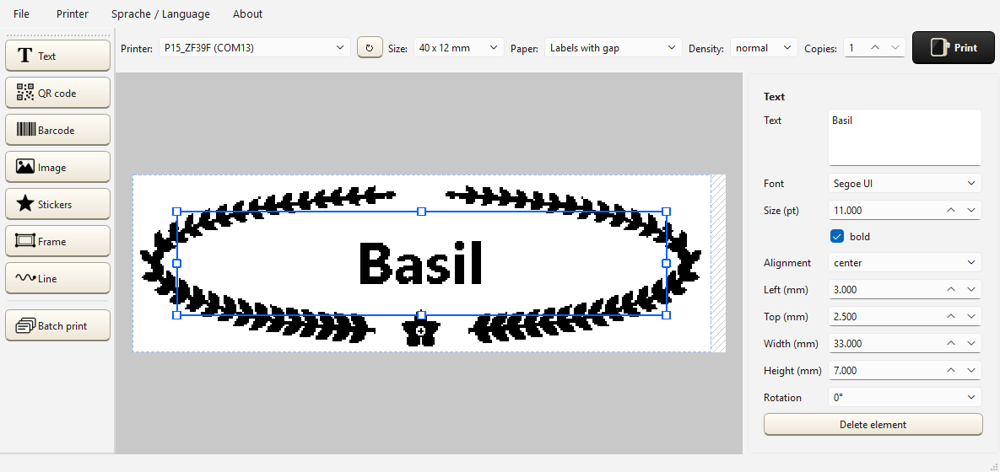
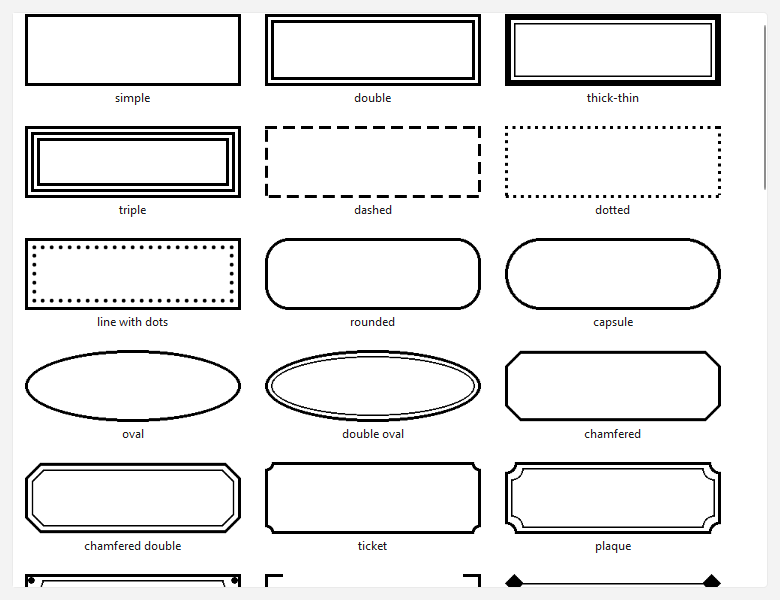
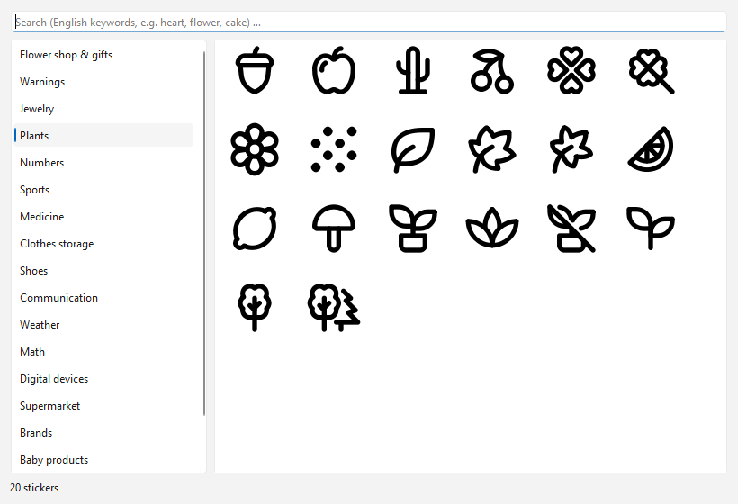
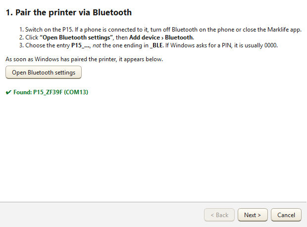
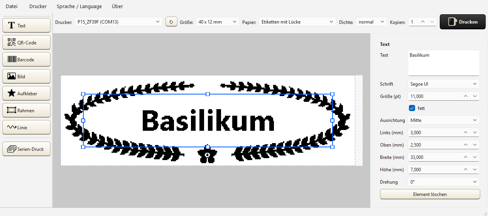
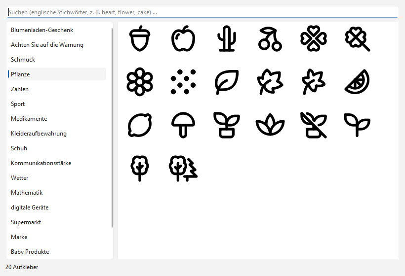
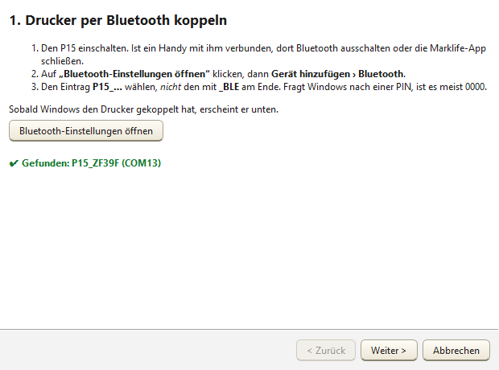

# Label Printer for the Marklife P15 / Etikettendrucker für den Marklife P15

**English** · [Deutsch](#deutsch)

A Windows program for designing labels and printing them on the **Marklife P15** Bluetooth thermal label printer. Text, QR codes, barcodes, images, stickers, about 50 decorative frames and lines each, and batch printing from CSV or Excel. The program talks to the printer directly over its Bluetooth serial port, so the manufacturer's Windows driver is not needed.

German and English. The language is chosen on first start and can be switched any time in the menu.



## Download

Get `Etikettendrucker-1.1-portabel.zip` from the [latest release](https://github.com/besarion099-hash/marklife-p15-label-printer/releases/latest), unzip it anywhere (even on a USB stick) and start `Etikettendrucker.exe`. No installation and no Python needed. Windows 10 or 11.

The EXE is not digitally signed. On first start Windows may show "Windows protected your PC"; click **More info** and **Run anyway**. With *Smart App Control* switched on, Windows blocks unsigned programs entirely. Use the [source code](#running-from-source) in that case.

## Features

- **Editor**: text (font, size, bold, alignment), QR code, barcode (Code 128, EAN-13), images (dithering for photos, threshold for logos), drag and resize with eight handles, snapping to the printer's 0.125 mm dot grid. What you see is exactly the bitmap the printer gets.
- **Frames and lines**: about 50 each, from simple and Art Deco to flourishes, laurel wreaths, flower meadows, mushrooms, lavender and mountains. All drawn for 203 dpi thermal printing (strokes of at least two dots, no solid areas).
- **Stickers**: over 5,000 free [Tabler Icons](https://tabler.io/icons) (MIT) sorted into categories, plus your own PNG/SVG files.
- **Batch printing**: write `{{Name}}` into a text, QR code or barcode and print one label per row of a CSV or Excel table, with preview and resume after errors.
- **Templates**: save and open labels as `.etikett.json`.
- **Setup assistant**: helps pair the P15 via Bluetooth and, optionally, installs it as a regular Windows printer (for printing from Word or a browser). The driver is downloaded from the manufacturer's website and its signature is checked before the installer runs.

| Frames | Stickers | Setup assistant |
|---|---|---|
|  |  |  |

## First steps

1. Switch on the P15. If a phone is connected to it, turn off Bluetooth on the phone.
2. Start the program and choose the language.
3. The setup assistant opens if no P15 is paired yet. Click **Open Bluetooth settings**, add the device **P15_…** (not the one ending in `_BLE`) and wait until the assistant shows it.
4. Design a label and click **Print**.

The defaults are set for 40 × 12 mm labels. If the print is upside down or off center, use **Printer › Test orientation** and **Printer › Fine-tune position**. More in [Manual.txt](Manual.txt).

## Running from source

Needs [uv](https://docs.astral.sh/uv/) with Python 3.11 (`uv python install 3.11`).

```bat
install.bat
```

This creates a virtual environment, installs the packages, downloads the Tabler Icons, asks for the language and creates Start menu and desktop shortcuts. Tests: `venv\Scripts\python.exe -m pytest`. Portable build: `venv\Scripts\python.exe -m pip install -r requirements-bau.txt`, then `venv\Scripts\python.exe bauen.py`. Screenshots: `venv\Scripts\python.exe screenshots.py`.

## Notes

This project is not affiliated with Marklife or Shenzhen Yinxiaoqian Technology. "Marklife" and "P15" are names of their product and are used here only to say which printer the program works with. The print commands were worked out on the author's own printer by recording what the official Windows driver sends. The manufacturer's driver and the stickers from the Marklife app are not part of this repository.

Made by Besarion, programmed with Claude (Anthropic) in Claude Code.

## License

[MIT](LICENSE). The Tabler Icons downloaded by `install.bat` are under their own [MIT license](https://github.com/tabler/tabler-icons/blob/main/LICENSE).

---

<a id="deutsch"></a>

# Etikettendrucker für den Marklife P15

[English](#label-printer-for-the-marklife-p15--etikettendrucker-für-den-marklife-p15) · **Deutsch**

Ein Windows-Programm zum Gestalten und Drucken von Etiketten auf dem Bluetooth-Thermodrucker **Marklife P15**: Text, QR-Codes, Barcodes, Bilder, Aufkleber, je rund 50 Zierrahmen und Linien und Serien-Druck aus CSV oder Excel. Das Programm spricht den Drucker direkt über seinen seriellen Bluetooth-Anschluss an und braucht den Windows-Treiber des Herstellers nicht.

Deutsch und Englisch. Die Sprache wird beim ersten Start gewählt und lässt sich jederzeit im Menü umstellen.



## Herunterladen

`Etikettendrucker-1.1-portabel.zip` aus dem [neuesten Release](https://github.com/besarion099-hash/marklife-p15-label-printer/releases/latest) laden, irgendwohin entpacken (auch auf einen USB-Stick) und `Etikettendrucker.exe` starten. Keine Installation, kein Python. Windows 10 oder 11.

Die EXE ist nicht digital signiert. Beim ersten Start zeigt Windows eventuell „Der Computer wurde durch Windows geschützt“; dann auf **Weitere Informationen** und **Trotzdem ausführen** klicken. Ist die *Intelligente App-Steuerung* (Smart App Control) eingeschaltet, blockiert Windows unsignierte Programme ganz. Dann den [Quellcode](#aus-dem-quellcode-starten) nehmen.

## Was es kann

- **Editor**: Text (Schrift, Größe, fett, Ausrichtung), QR-Code, Barcode (Code 128, EAN-13), Bilder (Fehlerverteilung für Fotos, Schwelle für Logos), Ziehen und Größe ändern an acht Griffen, Einrasten auf das 0,125-mm-Raster des Druckers. Was man sieht, ist genau das Bild, das der Drucker bekommt.
- **Rahmen und Linien**: je rund 50, von schlicht über Art déco und Schnörkel bis zu Lorbeerkranz, Blumenwiese, Pilzen, Lavendel und Bergen. Alle für den Thermodruck mit 203 dpi gezeichnet (Striche mindestens zwei Druckpunkte, keine Vollflächen).
- **Aufkleber**: über 5000 freie [Tabler Icons](https://tabler.io/icons) (MIT) in Kategorien, dazu eigene PNG/SVG-Dateien.
- **Serien-Druck**: `{{Name}}` in Text, QR-Code oder Barcode schreiben und je Zeile einer CSV- oder Excel-Tabelle ein Etikett drucken, mit Vorschau und Weitermachen nach Fehlern.
- **Vorlagen**: Etiketten als `.etikett.json` speichern und öffnen.
- **Einrichtungs-Assistent**: hilft beim Koppeln per Bluetooth und richtet den P15 auf Wunsch als normalen Windows-Drucker ein (für Word oder den Browser). Den Treiber lädt er von der Seite des Herstellers und prüft vor dem Start des Installers die Signatur.

| Rahmen | Aufkleber | Einrichtungs-Assistent |
|---|---|---|
|  |  |  |

## Erste Schritte

1. Den P15 einschalten. Ist ein Handy mit ihm verbunden, dort Bluetooth ausschalten.
2. Das Programm starten und die Sprache wählen.
3. Ist noch kein P15 gekoppelt, öffnet sich der Einrichtungs-Assistent. **Bluetooth-Einstellungen öffnen** anklicken, das Gerät **P15_…** hinzufügen (nicht das mit `_BLE` am Ende) und warten, bis der Assistent es anzeigt.
4. Ein Etikett gestalten und **Drucken** klicken.

Die Vorgaben passen für Etiketten 40 × 12 mm. Steht der Druck auf dem Kopf oder sitzt er nicht mittig, helfen **Drucker › Ausrichtung testen** und **Drucker › Lage feinjustieren**. Mehr in der [Anleitung.txt](Anleitung.txt).

## Aus dem Quellcode starten

Braucht [uv](https://docs.astral.sh/uv/) mit Python 3.11 (`uv python install 3.11`).

```bat
install.bat
```

Das legt eine virtuelle Umgebung an, installiert die Pakete, lädt die Tabler Icons, fragt nach der Sprache und legt Verknüpfungen im Startmenü und auf dem Desktop an. Tests: `venv\Scripts\python.exe -m pytest`. Portable Fassung: `venv\Scripts\python.exe -m pip install -r requirements-bau.txt`, dann `venv\Scripts\python.exe bauen.py`. Bildschirmfotos: `venv\Scripts\python.exe screenshots.py`.

## Hinweise

Dieses Projekt hat nichts mit Marklife oder Shenzhen Yinxiaoqian Technology zu tun. „Marklife“ und „P15“ sind Namen ihres Produkts und stehen hier nur, um zu sagen, für welchen Drucker das Programm ist. Die Druckbefehle wurden am eigenen Drucker ermittelt, indem aufgezeichnet wurde, was der offizielle Windows-Treiber sendet. Der Treiber des Herstellers und die Aufkleber aus der Marklife-App sind nicht in diesem Repository.

Gemacht von Besarion, programmiert mit Claude (Anthropic) in Claude Code.

## Lizenz

[MIT](LICENSE). Die Tabler Icons, die `install.bat` lädt, stehen unter ihrer eigenen [MIT-Lizenz](https://github.com/tabler/tabler-icons/blob/main/LICENSE).
